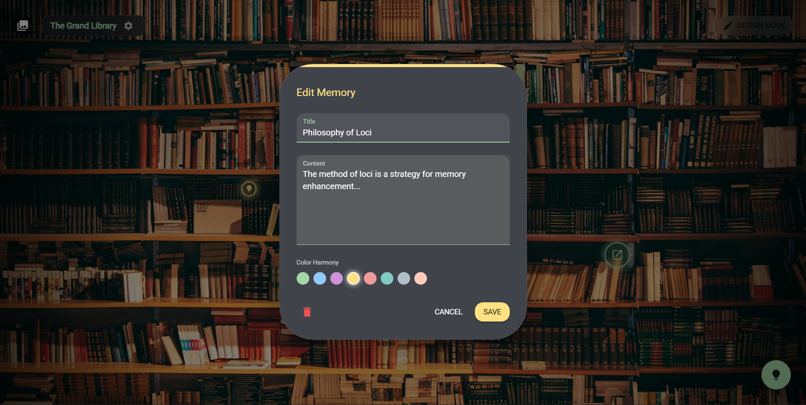
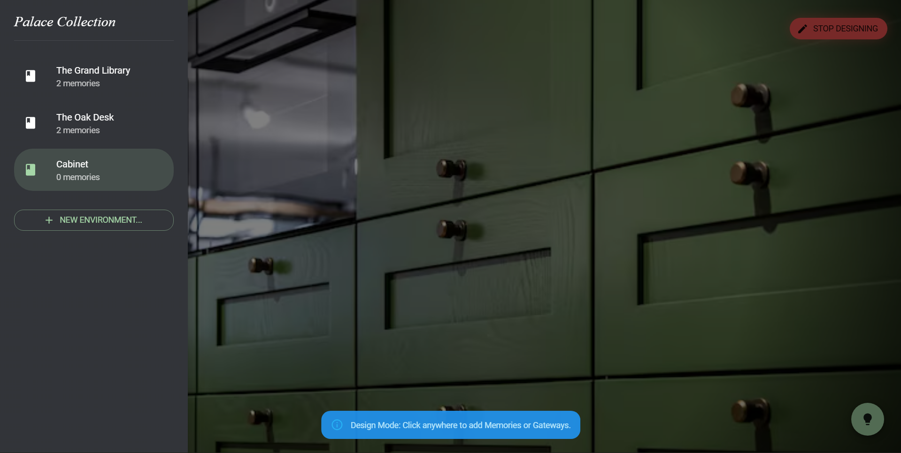
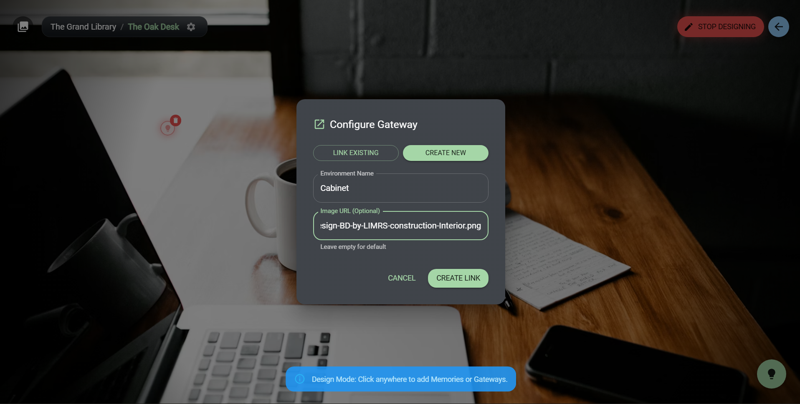
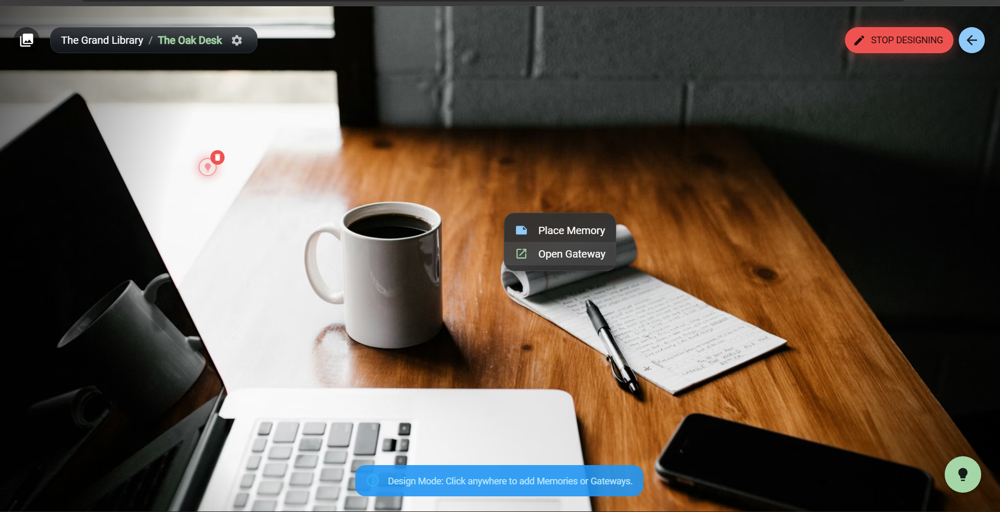

# LociCanvas

LociCanvas is a visual digital memory palace based on the Method of Loci. Create virtual environments, place notes at meaningful positions, and connect environments using gateway markers.

## Current features

- Visual palace environments with background image URLs.
- Memory notes with title, content, and accent colors.
- Gateway markers linking environments.
- Breadcrumb and collection navigation.
- Design mode for adding memories and gateways.
- Drag markers to reposition them while Design Mode is active.
- Create environments from the Palace Collection drawer.
- Built-in guide dialog.
- Browser-local persistence using a versioned JSON envelope, with support for reading the older array format.
- Export a versioned JSON backup and import a validated backup after explicit replacement confirmation.
- Best-effort recovery copy preservation with an in-app recovery action.
- HTTPS-only validation for new or edited background-image URLs.
- Responsive, full-width editor dialogs on smaller screens.
- Validation of saved palace/marker structure and broken gateway references.

## Technology

- React 19 and Vite 7
- Material UI 7
- Framer Motion 12
- Browser `localStorage` (current persistence; no accounts or cloud sync yet)
- Node.js test runner for domain-level tests

## Run locally

Use a current Node.js LTS release, then from this directory:

```sh
npm ci
npm run dev
```

Vite prints the local development URL. To run the available checks:

```sh
npm test
npm run lint
npm run build
```

## Data persistence and recovery

The application uses the browser storage key `locicanvas_v2_data`. New saves use an envelope containing `schemaVersion` and `palaces`; existing valid array-format data is still read and migrated on the next successful save.

If saved data is malformed or fails structural validation, the app attempts to preserve the raw value under `locicanvas_v2_data_recovery` and loads the sample collection instead of silently treating malformed data as an empty collection. Browser storage may be unavailable or full, so this recovery copy is best-effort. Do not clear site data if you need to recover a previous collection.

Data is still local to a browser profile and origin. It is not synchronized across devices, and clearing browser storage can remove it. Cloud accounts, database persistence, and deployment are planned separately; they are not implemented in this phase.

## Project structure

- `src/App.jsx`: application UI and interactions.
- `src/domain/palaceModel.js`: pure coordinate, movement, storage parsing/serialization, and gateway-cleanup operations.
- `src/domain/palaceModel.test.js`: tests for domain operations and data validation.
- `vite.config.js`: Vite configuration.
- `IMPROVEMENT_PLAN.md`: phased multi-user upgrade plan and architecture decisions.
- `supabase/migrations/`: version-controlled PostgreSQL schema and RLS policies.
- `SUPABASE_SETUP.md`: database setup, migration deployment, and cloud-security verification checklist.

## GitHub Pages deployment

The repository includes a GitHub Actions workflow at `.github/workflows/locicanvas-pages.yml`. It tests, builds, and deploys LociCanvas when relevant changes reach `main`, and it can also be run manually from the Actions tab.

Before its first successful deployment, open **Repository Settings → Pages → Build and deployment** and set **Source** to **GitHub Actions**. Then review the LociCanvas Pages workflow in the Actions tab. The project-site base path is configured as `/Full_Stack2/`, because LociCanvas lives inside the larger repository.

Expected site URL: https://shreyasgautam01.github.io/Full_Stack2/

GitHub Pages only serves the static frontend. The deployment workflow has completed successfully, but this version continues to store data in the current browser's localStorage; it does **not** yet offer accounts, cloud persistence, or cross-device synchronization. The Supabase schema foundation is being added separately; the frontend must not be considered cloud-connected until the authentication and repository integration is implemented.

## Current limitations

- No authentication, cloud database, or cross-device synchronization.
- No background-image upload; backgrounds are supplied as HTTPS URLs.
- Import currently accepts pasted JSON backup content; direct file-picker import is not implemented.
- Browser-local recovery remains best-effort and depends on browser storage being accessible.
- Palace deletion UI, search, tags, and undo/redo are not implemented yet.
- A successful Pages deployment is recorded in GitHub Actions, but direct browser/device smoke tests and accessibility checks remain outstanding.
- The Supabase migration defines the security-oriented database foundation only; no frontend Supabase client or authentication flow is wired up yet.

## Screenshots






